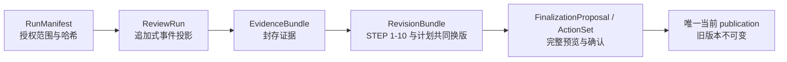

# AI Stock Review

面向有既定交易框架的个人投资者的本地优先 A 股短线盘后复盘系统。它按 [`stock-review.md`](stock-review.md) 的 STEP 1-10 组织证据、判断、次日条件计划、Observation 回填和周度学习，并以不可变版本保存可追溯结果。系统不替用户做买卖决定。

## 当前状态

- 新版 ReviewRun 领域对象和 CLI 已实现，默认使用独立的 `data/review_run.sqlite`；首次 `daily start` 可以创建 schema version 1。
- 旧 `data/stock_review.sqlite` 保持历史旧链边界。新版日常命令默认不读写它，两个数据库没有自动合并能力。
- WorkBuddy Skill 已同步当前 CLI 合同，但真实 WorkBuddy 端到端验收和连续五个交易日试跑尚未完成。
- 旧 CLI 和 `scripts/run_daily_review.ps1` 在真实 WorkBuddy 验收前暂留，只能作为过渡入口，不能产生新版正式 publication。
- 新增盘后决策卡入口 `python -m stock_review.decision --date DATE`，直接回答「情绪 / 能否参与 / 参与什么 / 参与多少」；它与 ReviewRun 正式链并存，最终地位待用户确认。
- 本地自动化测试、离线样例和文档不能证明真实数据源、真实模型或真实复盘效果已经通过验收。

当前产品合同见 [`docs/PRODUCT_REQUIREMENTS.md`](docs/PRODUCT_REQUIREMENTS.md)，项目文档的职责和权威边界见 [`docs/README.md`](docs/README.md)。根目录 `PRD.md` 与 [`docs/REVIEW_QUALITY_REDESIGN.md`](docs/REVIEW_QUALITY_REDESIGN.md) 仅保留历史背景。

## 最快开始

目前可以把 WorkBuddy 作为首轮真实试跑入口。将本仓库设为工作空间后说“复盘 YYYY-MM-DD”，并提供：

1. 精确的正式分析 model ID，以及平台支持时的推理强度。
2. 首日需要跟踪的小型板块和股票清单；后续可以从新版正式池继续维护。
3. 对完整 RunManifest 的首次对象确认。
4. 将冻结请求交给该正式模型的独立调用授权。
5. 对最终判断、计划、变更和报告预览组成的 FinalizationProposal 的第二次对象确认。

提供 model ID 只确定身份，不等于授权真实调用。WorkBuddy 应转交 Base64、operation ID、修订 ID 和哈希，用户不需要手工拼接命令。正式模型不可用、actual model ID 不一致、证据不足或身份无法核实时，流程应明确阻断，不得静默换模型或把缺证据包装成“不参与”。最终以 `daily verify` 通过作为单次运行的技术收口。

这仍是待验收的试跑入口。完整编排合同和采集范围见 [`integrations/workbuddy/README.md`](integrations/workbuddy/README.md) 与 [`integrations/workbuddy/stock-review/SKILL.md`](integrations/workbuddy/stock-review/SKILL.md)。

## 盘后决策卡

需要"今天情绪怎么样、明天能不能买、买什么、买多少"的当日结论时，使用决策卡入口，不需要两次对象确认：

```powershell
.\.venv\Scripts\python.exe -m stock_review.decision --date 2026-10-09
```

它的定位、规则来源、数据来源与已知限制见 [`docs/DECISION_CARD.md`](docs/DECISION_CARD.md)。决策卡定位为**独立决策入口**（2026-10-09 确认），不写 `data/review_run.sqlite`、不创建 publication、不进入 `reports/daily/`，因此不能表述为正式复盘，也不构成平行正式流程。

规则或渲染变更后，可用 `--from-snapshot data\decision\<trade-date>.json` 从既有快照重渲染已归档交易日——只读回当日已落盘的事实，不重新采集任何外部数据，与「禁止给历史日期补跑」不冲突。详见 [`docs/DECISION_CARD.md`](docs/DECISION_CARD.md)。

决策卡可选用通达信连接器补充证据：Agent 把当日通达信事实落成 `data/decision/tdx/<trade-date>.json`，决策卡运行时自动读取，用于补全概念板块、解析候选代码、附上个股涨停逻辑与当日消息面。该快照由**每交易日盘后任务自动采集**，采集步骤见 [`docs/DECISION_TDX_COLLECTION.md`](docs/DECISION_TDX_COLLECTION.md)；采集后必须自校验：

```powershell
.\.venv\Scripts\python.exe -m stock_review.decision.tdx_snapshot --date 2026-10-09
```

快照缺失或自校验不通过时，决策卡照常产出并写明相应缺口。

## 核心异动票跟踪

需要长期跟踪「进过异动的核心票」在见顶后的调整位置时，使用跟踪入口。候选由模块自动收集，审核后入池，再按交易日出跟踪表：

```powershell
# 1) 自动收集异动候选（龙虎榜 + 涨停池 + 强势股池），审核后入池
.\.venv\Scripts\python.exe -m stock_review.watchlist candidates --date 2026-10-14
.\.venv\Scripts\python.exe -m stock_review.watchlist pool-add --code 301251 --name 威尔高 --reason "严重异常波动"

# 2) 按交易日出跟踪表（位置 / 量价 / 异动认定 / 龙虎榜 / 资金流向）
.\.venv\Scripts\python.exe -m stock_review.watchlist run --date 2026-10-14
```

它的定位、口径与已知限制见 [`docs/WATCHLIST.md`](docs/WATCHLIST.md)。与决策卡同为**独立决策入口**：不写 `data/review_run.sqlite`、不创建 publication、不进入 `reports/daily/`。产物落在 `reports/watchlist/` 与 `data/watchlist/`。数据全部走 AKShare 直连（前复权日线、指数日线、龙虎榜、资金流向），因此可无人值守运行。

## 唯一正式流程

正式对象链固定为：



运行顺序为：

1. `daily plan` 只读生成并展示 RunManifest。
2. `daily start` 创建 ReviewRun，直接来源按清单采集，外部材料通过 `attach-evidence` 进入受限槽位。
3. 所有槽位到达终态后，`seal-evidence` 封存不可变 EvidenceBundle。
4. `complete-local` 生成保守草案；正式模型内容通过 `prepare-model → complete-model` 留痕，结构变化通过完整 `revise` 联合换版。
5. `propose-actions` 只读生成 FinalizationProposal、ActionSet 和完整报告预览。
6. `finalize` 校验正文、哈希、有效期和版本后原子提交；`verify` 核验数据库、版本链和报告 blob。

每个交易日只有一个当前 publication。EvidenceBundle 封存后不能追加，RevisionBundle 不能拼接不同版本，池和 Observation 状态只能来自已确认 ActionSet 或明确的 Observation 结果 action。完整不变量见 [`PROJECT_RULES.md`](PROJECT_RULES.md)。

## 开发与命令入口

项目要求 Python 3.12 或更高版本。初始化、测试、CLI 自检、Git 和数据库人工作业命令统一维护在 [`DEV_WORKFLOW.md`](DEV_WORKFLOW.md)，不要从历史文档复制命令；WorkBuddy 的精确机器编排参数由 Skill 维护。

新版默认资源：

| 对象 | 默认位置 | 说明 |
| --- | --- | --- |
| 正式数据库 | `data/review_run.sqlite` | ReviewRun schema version 1；旧库不是日常默认值 |
| 证据目录 | `data/evidence/` | 样例、外部信封和采集快照必须保留来源与日期边界 |
| 日报 | `reports/daily/` | publication 指向内容寻址的正式报告 blob |
| 周报 | `reports/weekly/` | 只冻结正式日报及其关联结果和池事件 |
| 审计日志 | `logs/review_run.log` | 数据库 audit outbox 的可恢复投影，不是权威事实库 |

本地数据、旧库、备份、恢复和清理边界见 [`docs/LOCAL_DATA_OPERATIONS.md`](docs/LOCAL_DATA_OPERATIONS.md)。

## 主要目录

```text
src/stock_review/review_runs/     ReviewRun 领域与每日应用服务
src/stock_review/evidence/        证据信封、规范化和来源适配
src/stock_review/storage/         Repository port、SQLite adapter、迁移与审计投影
src/stock_review/reports/         纯 Markdown 渲染
src/stock_review/observations/    Observation 结果提案与提交
src/stock_review/learning/        版本化周报
integrations/workbuddy/           待真实验收的 WorkBuddy 接入合同
tests/                            临时 SQLite、受控替身和离线样例测试
docs/                             正式产品文档、数据说明和历史材料索引
```

协作入口为 [`AGENTS.md`](AGENTS.md)，架构红线为 [`PROJECT_RULES.md`](PROJECT_RULES.md)，工程风格为 [`STYLE.md`](STYLE.md)，执行闭环为 [`AI_COLLABORATION.md`](AI_COLLABORATION.md)。复杂新需求按 [`REQUIREMENT_DEVELOPMENT.md`](REQUIREMENT_DEVELOPMENT.md) 建立单项合同。

## 明确不做

- 自动交易、下单、实时盯盘、仓位执行或收益承诺。
- 默认全市场扫描、全量资讯仓库或以扩充数据源和报告篇幅为目标的建设。
- 无证据的 AI 投资建议、由模型编造对象身份或把概率判断写成事实。
- 在 CLI 闭环稳定前新增 WebUI、后台 worker 或隐藏自动写入。
- 未经对应确认执行数据库迁移、真实联网、真实模型调用或其它超出 RunManifest 的业务写入。
