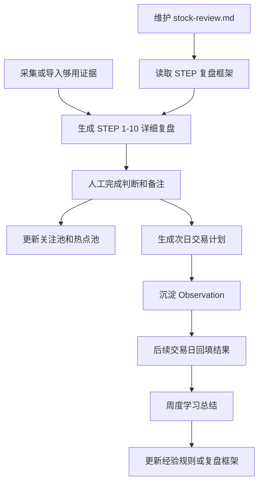

# 价值投机复盘助手

一个以 `stock-review.md` 为主流程、以有限股票池和必要行情/情绪数据为证据输入的 A 股短线盘后复盘与次日计划系统。

当前产品主线不是继续增加数据和功能，而是先把已经积累的当日事实、5 日历史和真实池收敛成一份低摩擦的盘后复盘决策卡；完整 STEP 1-10 详细报告保留为显式启用的补充输出。

## 项目负责

- 读取用户维护的 `stock-review.md`，严格按 `STEP N` 顺序生成每日详细复盘，不用其它总览结构替代原框架。
- 围绕复盘步骤补齐必要证据，包括市场环境、短线情绪、热点板块、核心个股和事件催化。
- 维护关注池、热点池、趋势强势池和潜在机会池，范围默认收敛在用户关注的 100-200 个股票内。
- 生成下一个交易日的观察计划，明确符合预期、超预期、不及预期和放弃条件。
- 把可验证判断沉淀为 Observation，并在后续交易日回填命中、失败、无效或待观察状态。
- 基于历史 Observation、热点池跟踪和交易计划回填生成周度学习总结。

## 项目不负责

- 不做自动交易。
- 不做实时盯盘系统。
- 不做全市场行情平台。
- 不做纯机器选股候选池。
- 不做普通资讯摘要工具。
- 不以数据源数量、字段数量或报告篇幅衡量复盘质量。
- 不默认堆叠资金流、龙虎榜、宏观新闻等信息；只有它们反复影响具体 STEP 判断时才单独评估。
- 不让 LLM 替代事实证据和人工判断。
- MVP 不做 WebUI。

## 核心流程



## 推荐技术栈

- 语言：Python 3.12 或 Python 3.13。
- CLI：M2 阶段使用 Python 标准库 `argparse`；后续命令复杂后再评估是否引入 Typer。
- 本地存储：SQLite。
- 数据模型校验：Pydantic。
- 配置和样例数据：YAML/JSON。
- 报告输出：Markdown。
- 测试：M2 阶段使用 Python 标准库 `unittest`；后续依赖安装稳定后再评估是否引入 pytest。
- 后续 LLM：OpenAI-compatible client，只用于基于证据的归纳和总结。

## 当前状态

- M1 文档已定版：当前需求以 `docs/PRODUCT_REQUIREMENTS.md` 为准，根目录 `PRD.md` 仅作为上一版经验参考。
- M2 已完成最小闭环：可以读取 `stock-review.md`，动态识别 `# STEP N: 标题`，并生成每日复盘 Markdown。
- M3 已完成最小离线闭环：可以导入本地 JSON 样例证据，生成 Evidence Snapshot，识别关键证据缺口，并写入本地 SQLite。
- M3.5 已完成最小接入：`review create` 可通过 `--evidence` 读取 Evidence Snapshot，并在日报中按 STEP 展示对应事实证据和风险缺口。
- M4.1 已完成最小池子管理：可以手工加入和查看关注池、热点池，同一池子内重复股票会报明确错误。
- M4.2 已完成最小次日计划：可以基于日报、Evidence Snapshot 和池子记录生成次日观察计划 Markdown。
- M4.5 已完成 AKShare 市场层最小接入口：提供 `evidence collect --source akshare --scope market`，用于采集指数和成交额 Evidence Snapshot；真实采集需先安装可选依赖。
- M4.6 已完成短线情绪和板块真实证据最小接入口：提供 `evidence collect --source akshare --scope sentiment|sectors`，用于采集涨停数、跌停数、炸板率、连板高度和热门板块事实。
- M4.7 已完成个股事实证据最小接入口：提供 `evidence collect --source akshare --scope stocks`，只提取已有板块领涨股和涨停池连板股事实，不认定核心票。
- M5 已完成 Observation 最小闭环：支持手工创建、按日期/状态查询，以及回填 `pending|hit|miss|invalid`。
- M6.1 已完成周度学习总结最小闭环：按日期范围汇总 Observation，区分命中、失败、无效和待观察样本，并输出可追溯经验候选。
- M6.2.1 已完成市场状态与板块强度可解释评分：固定规则输出得分、标签、证据覆盖率和字段缺口。
- M6.2.2 已完成个股角色标签与买点模式疑似匹配：只基于 Evidence Snapshot 已有个股事实生成候选标签和疑似观察模式，并展示证据缺口。
- M7.1 已完成 AKShare 采集稳定性最小闭环：同交易日同 scope 默认复用已有有效快照；重新联网需显式传入 `--refresh`；同次采集请求固定节流并标记失败类别，已完成 market scope 真实验证。
- M7.2 已完成候选短线情绪数据源可用性评估：当前没有可新增接入的数据源，继续保留 `missing_emotion_temperature` 和手工补录兜底。
- M8 已完成单日复盘闭环验收：`2026-07-10` 的日报、计划、Observation 回填和周度学习总结已按同一证据来源回查；缺口保持待确认，验收样例标记为 `invalid`，不进入经验候选。
- M9 已完成阶段性基线收口：已区分验证样例与真实业务数据，并补充本地离线验证、备份、恢复和清理边界。
- M10.1 已完成首个板块历史子闭环：可从本地快照输出每日最强板块事实、缺口日期和近期反复活跃候选；少于 5 个有效板块交易日时不认定核心板块。
- M10.1 已完成市场历史事实子闭环：可从本地快照输出每日指数、成交额和区间涨跌事实；少于 5 个有效市场交易日时不判断市场阶段。
- M10.1 已完成池子生命周期子闭环：可显式暂停、移出或重新启用池子对象，并保留每次状态变更原因与历史。
- M10.1 已完成单日多 scope 采集子闭环：用户显式指定 scope 后可顺序采集市场、情绪、板块和个股；部分失败不会覆盖已有事实，并按非零状态和日志提示。
- M10.1 已接入 hhxg 最近交易日快照：自动补充涨跌停、炸板、连板梯队与板块排行；截至 2026-07-16 已积累 5/5 个有效交易日，可展示多日事实，来源不可比字段继续保留缺口。
- M10.1 已为真实池日线增加腾讯备用路径：主日线失败时可补齐收盘、成交量和 5/20 日涨跌幅；备用源的手数不写作成交额，真实联网可用性仍需逐日验证。
- M10.2 已完成 STEP 1-7 固定字段映射与硬缺口：多日市场与 hhxg 历史事实仅进入 STEP 1-4，真实池 5/20 日事实仅进入 STEP 6/7；缺口固定保留为 `unavailable` 或待确认，不判断阶段、核心票或买点。
- M10.3 已完成结构化人工复盘链路：可保存人工 STEP 判断、经用户确认的 STEP 8 预演和 STEP 10 最终应对，并显式关联真实池、计划 Markdown 项和 Observation；`review draft-final` 可通过本地 `.env` 配置的 OpenAI-compatible LLM 生成不落库的待确认草案。
- 2026-07-14 已完成百炼 LLM 草案真实调用验证：快照事实和真实池由本地固定渲染，模型只能选择当前 STEP 允许的字段与对象关联；草案不写入业务数据、不构成买卖建议。
- M10.4 已完成 STEP 9 模式核验清单：当前 12 项模式逐项展示盘后背景、次日触发事实和失效边界；背景满足但缺竞价/分时时标记 `background_matched_trigger_pending`，不再把整项误报为不可用。
- M10.4.1 已完成详细复盘报告编排及真实使用修正：`review create-detailed` 复用现有事实、历史、系统发现候选、真实池、人工记录和模式核验，按 `stock-review.md` 的 STEP 1-10 输出；证据字段由本地按 STEP 白名单和事实可用性固定，STEP 1-7 的精确历史事实只由本地证据链渲染，额外模型字段键不会参与业务判断。
- M10.4.2 已完成真实可用性修正：hhxg `sentiment_index` 按页面口径记录为赚钱效应且明确公式未公开；有限系统候选与真实池可补采 5/20 日、5 日均成交额和流通市值，逐只进入 STEP 2/6/7；STEP 8 先给主情景和值博率方向，四类条件改为相对分支和否决线。
- M10.4.3 已完成直接行动计划边界：详细复盘各 STEP 均允许条件买卖、低吸、打板和仓位表达，不再维护动作词黑名单；STEP 8/10 可输出 AI 条件阈值、参与结论、总仓位及逐候选行动，STEP 8 的大盘、板块和个股三类输出及证据路由由本地固定。风险由用户自行承担但不保证市场结果；候选代码仍限于本地有限范围，身份未验证时不得认定龙头、中军或核心票；STEP 9 逐项展示全部 12 种模式。
- 日常入口默认生成不依赖 LLM 的盘后复盘决策卡：只在决策区展示本地事实、有效真实池和待人工确认项，未确认系统候选仅进入附录；传入 `-WithLlm` 时才额外生成原 STEP 1-10 详细复盘。
- M10.5.1 已完成 Observation 回填治理代码闭环：新建记录必须指定最晚回填日期，逾期 `pending` 只提示不改状态，`miss/invalid` 必须选择固定原因分类，周报展示分类计数和 Observation ID；现有真实库尚未执行结构迁移。
- 池子对象已支持最多 3 个人工确认板块；旧单板块本地库需显式执行 `pool migrate-sectors` 后才可写入新结构。
- 后续顺序：先连续使用本地盘后复盘决策卡，确认能稳定完成每日人工判断；再根据反复出现的硬缺口决定是否补数据，最后积累真实 Observation 样本并进入学习和框架演进。具体边界见 `docs/PRODUCT_REQUIREMENTS.md`。
- 当前 `stock-review.md` 实际包含 `STEP 1` 到 `STEP 10`，命令会按文件内容动态识别，不硬编码 STEP 数量。
- 当前已在本地开发环境完成 2026-07-06 的真实联网采集验证；MVP 暂不建设 WebUI。
- 个股角色标签和买点模式疑似匹配只基于数据源明确给出的板块领涨、连板等事实，不能认定核心票、龙头或确认买点。
- 当前日报只展示 Evidence Snapshot 中已有字段，禁止生成没有证据支持的市场、板块或个股结论。
- 当前详细复盘可以输出 AI 条件买卖与仓位方案，但不会自动交易或写入业务数据；历史事实准确性仍由本地证据链约束。
- 当前已在本地开发环境完成 2026-07-06 的 M4.7 真实联网个股采集，快照只剩 `missing_emotion_temperature`。

## 最小启动

如需使用 `review draft-final` 或 `review create-detailed`，在仓库根目录的 `.env` 填写 `LLM_BASE_URL`、`LLM_API_KEY` 和 `LLM_MODEL`。该文件已被 Git 忽略，系统环境变量同名值优先；不要提交或在对话中粘贴密钥。`deepseek-*` 模型使用百炼流式接口；v3.1、v3.2 和 v4 混合思考模型在结构化复盘中关闭思考，R1 等仅思考模型保持思考并只解析最终回答。其他支持 JSON Mode 的模型继续请求 JSON 对象。两种模式的结果都必须通过本地事实字段和业务边界校验后才能进入报告。

当前仓库已创建最小源码包；首次使用请按下方命令创建虚拟环境并以 `.venv\Scripts\python.exe` 运行 CLI。

可选初始化：

```powershell
python -m venv .venv
.\.venv\Scripts\python.exe -m pip install -e .[dev,data]
```

当前已实现 CLI：

```powershell
.\.venv\Scripts\python.exe -m stock_review.cli framework check --file stock-review.md
.\.venv\Scripts\python.exe -m stock_review.cli review create --date 2026-07-06 --framework stock-review.md
.\.venv\Scripts\python.exe -m stock_review.cli review create --date 2026-07-06 --framework stock-review.md --evidence data/evidence/2026-07-06_snapshot.json
.\.venv\Scripts\python.exe -m stock_review.cli review create-brief --date 2026-07-06 --snapshot-dir data/evidence --database data/stock_review.sqlite --output-dir reports/daily
.\.venv\Scripts\python.exe -m stock_review.cli review record-step --date 2026-07-06 --step 1 --judgment "市场阶段待确认" --evidence-reference data/evidence/2026-07-06_snapshot.json
.\.venv\Scripts\python.exe -m stock_review.cli review record-preview --date 2026-07-06 --target "机器人板块" --expectation "板块延续强势" --over-expectation "板块放量强化" --under-expectation "板块明显走弱" --abandon-condition "证据缺失时放弃观察" --evidence-reference data/evidence/2026-07-06_snapshot.json --confirmed
.\.venv\Scripts\python.exe -m stock_review.cli review record-final --date 2026-07-06 --response "只观察反馈，不形成操作结论" --risk-boundary "证据不足时放弃" --evidence-reference data/evidence/2026-07-06_snapshot.json --plan-reference reports/daily/2026-07-06_plan.md --plan-item "计划项 1: 002829 星网宇达" --pool-code 002829 --preview-id PREVIEW-20260706-001 --observation-id OBS-20260706-001 --confirmed
.\.venv\Scripts\python.exe -m stock_review.cli review list-records --date 2026-07-06
.\.venv\Scripts\python.exe -m stock_review.cli review build-context --date 2026-07-06 --snapshot-dir data/evidence --database data/stock_review.sqlite
.\.venv\Scripts\python.exe -m stock_review.cli review draft-final --date 2026-07-06 --snapshot-dir data/evidence --database data/stock_review.sqlite
.\.venv\Scripts\python.exe -m stock_review.cli review create-detailed --date 2026-07-06 --framework stock-review.md --snapshot-dir data/evidence --database data/stock_review.sqlite --output-dir reports/daily
.\.venv\Scripts\python.exe -m stock_review.cli evidence import --date 2026-07-06 --file data/evidence/2026-07-06_sample.json
.\.venv\Scripts\python.exe -m stock_review.cli evidence check --date 2026-07-06
.\.venv\Scripts\python.exe -m stock_review.cli evidence sector-history --start 2026-07-06 --end 2026-07-10 --snapshot-dir data/evidence --output-dir reports/daily
.\.venv\Scripts\python.exe -m stock_review.cli evidence market-history --start 2026-07-06 --end 2026-07-10 --snapshot-dir data/evidence --output-dir reports/daily
.\.venv\Scripts\python.exe -m stock_review.cli pool add-watch --code 000001 --name 平安银行 --date 2026-07-06 --reason 样例关注 --exchange SZSE --sector 银行
.\.venv\Scripts\python.exe -m stock_review.cli pool add-hot --code 600519 --name 贵州茅台 --date 2026-07-06 --reason 样例热点 --exchange SSE --sector 白酒 --sector 消费
.\.venv\Scripts\python.exe -m stock_review.cli pool migrate-sectors --database data/stock_review.sqlite
.\.venv\Scripts\python.exe -m stock_review.cli pool list
.\.venv\Scripts\python.exe -m stock_review.cli pool list --record-kind real
.\.venv\Scripts\python.exe -m stock_review.cli pool update-record-kind --type hot --code 600519 --record-kind sample --reason 系统验收样例
.\.venv\Scripts\python.exe -m stock_review.cli pool candidates --date 2026-07-10 --snapshot-dir data/evidence
.\.venv\Scripts\python.exe -m stock_review.cli pool update-status --type watch --code 000001 --status paused --reason 等待板块确认
.\.venv\Scripts\python.exe -m stock_review.cli pool history --type watch --code 000001
.\.venv\Scripts\python.exe -m stock_review.cli plan create --date 2026-07-06 --review reports/daily/2026-07-06_review.md --evidence data/evidence/2026-07-06_snapshot.json
.\.venv\Scripts\python.exe -m stock_review.cli evidence collect --date 2026-07-06 --source akshare --scope market --output-dir data/evidence
.\.venv\Scripts\python.exe -m stock_review.cli evidence collect --date 2026-07-06 --source akshare --scope sentiment --output-dir data/evidence
.\.venv\Scripts\python.exe -m stock_review.cli evidence collect --date 2026-07-06 --source akshare --scope sectors --output-dir data/evidence
.\.venv\Scripts\python.exe -m stock_review.cli evidence collect --date 2026-07-06 --source akshare --scope stocks --output-dir data/evidence
.\.venv\Scripts\python.exe -m stock_review.cli evidence collect-daily --date 2026-07-06 --source akshare --scope market --scope sentiment --scope sectors --scope stocks --output-dir data/evidence
.\.venv\Scripts\python.exe -m stock_review.cli evidence collect-pool-history --date 2026-07-10 --source akshare --output-dir data/evidence
.\.venv\Scripts\python.exe -m stock_review.cli evidence collect-review-history --date 2026-07-10 --source akshare --snapshot-dir data/evidence --output-dir data/evidence
.\.venv\Scripts\python.exe -m stock_review.cli evidence history-readiness --source hhxg --start 2026-07-06 --end 2026-07-10 --snapshot-dir data/evidence
.\.venv\Scripts\python.exe -m stock_review.cli evidence summarize-review --date 2026-07-10 --snapshot-dir data/evidence --pool-history-dir data/evidence --output-dir reports/daily
.\.venv\Scripts\python.exe -m stock_review.cli evidence collect --date 2026-07-06 --source akshare --scope sentiment --output-dir data/evidence --refresh
.\.venv\Scripts\python.exe -m stock_review.cli observation migrate-review-governance --database data/stock_review.sqlite
.\.venv\Scripts\python.exe -m stock_review.cli observation add --date 2026-07-06 --topic 机器人板块延续性 --target 机器人板块 --hypothesis 机器人板块次日保持强势 --confirmation 板块次日继续放量 --invalidation "板块跌幅超过 2%" --evidence-source "2026-07-06 Evidence Snapshot" --review-deadline 2026-07-08
.\.venv\Scripts\python.exe -m stock_review.cli observation list --date 2026-07-06 --status pending
.\.venv\Scripts\python.exe -m stock_review.cli observation review --id OBS-20260706-001 --status miss --result "板块未达到成立条件" --reason-category judgment_error --note 判断需要修正
.\.venv\Scripts\python.exe -m stock_review.cli learning weekly --start 2026-07-06 --end 2026-07-10
.\.venv\Scripts\python.exe -m stock_review.cli scoring create --date 2026-07-06 --evidence data/evidence/2026-07-06_snapshot.json
```

日常收盘后可使用单入口脚本依次完成 AKShare 四范围采集、hhxg 合并、快照检查、有限候选历史采集和本地盘后复盘决策卡。决策卡不调用 LLM，部分证据缺失时仍会保留缺口并生成；系统候选只进入附录，不自动进入行动计划。必须显式传入实际交易日期；hhxg 只返回最近交易日，指定日期与返回日期不一致时脚本会在该步停止，不会继续生成错日复盘。

```powershell
.\scripts\run_daily_review.ps1 -TradeDate 2026-07-23
```

如需在决策卡之外继续生成原 STEP 1-10 LLM 详细复盘，必须显式传入：

```powershell
.\scripts\run_daily_review.ps1 -TradeDate 2026-07-23 -WithLlm
```

只检查将要执行的命令，不联网、不写文件或调用 LLM：

```powershell
.\scripts\run_daily_review.ps1 -TradeDate 2026-07-23 -DryRun
```

脚本任一步返回非零退出码时立即停止，不自动重试。默认执行成功后生成 `data/evidence/YYYY-MM-DD_snapshot.json`、`data/evidence/YYYY-MM-DD_review_candidate_history.json` 和 `reports/daily/YYYY-MM-DD_brief_review.md`；传入 `-WithLlm` 时额外生成 `reports/daily/YYYY-MM-DD_detailed_review.md`。

## WorkBuddy 集成

仓库提供可导入 WorkBuddy 的本地 `stock-review` Skill，入口和五日试跑说明见 [`integrations/workbuddy/README.md`](integrations/workbuddy/README.md)。Skill 把 WorkBuddy 限制为交互和确认层：始终先执行 DryRun，真实采集、人工判断写入和 Observation 创建分别要求用户明确确认；业务事实仍只由现有 CLI、Evidence Snapshot 和 SQLite 管理。

测试：

```powershell
$env:PYTHONDONTWRITEBYTECODE='1'
.\.venv\Scripts\python.exe -m unittest discover -s tests
```

## 目录说明

- `AGENTS.md`：AI 协作约束、任务分级、工程风格、项目架构红线和证据收口。
- `README.md`：项目入口说明、核心流程、技术栈和启动口径。
- `docs/PRODUCT_REQUIREMENTS.md`：当前项目需求、功能拆解、数据边界、MVP 里程碑和风险控制。
- `docs/LOCAL_DATA_OPERATIONS.md`：本地数据分类、离线验证、备份、恢复和清理边界。
- `PRD.md`：上一版失败项目材料，仅作为经验教训和背景参考，不作为当前定版需求。
- `stock-review.md`：用户维护的盘后复盘框架，是系统主流程来源。
- `src/stock_review/`：主工程源码，当前包含 CLI、复盘框架解析、Evidence Snapshot、真实池历史、人工复盘、LLM 草案、STEP 9 模式核验、计划、Observation、学习总结、Markdown 渲染和 SQLite repository。
- `tests/`：自动化测试目录，当前覆盖 STEP 识别、证据与数据源降级、真实池历史、固定 STEP 字段映射、人工复盘、LLM 草案、STEP 9 模式核验、计划、Observation 和学习总结。
- `data/`：本地样例数据、证据快照、池子记录和本地 SQLite，当前 `data/evidence/` 保存离线样例和标准化快照。
- `reports/`：Markdown 输出目录，`reports/daily/` 用于日报和计划，`reports/weekly/` 用于周度学习总结。
- `logs/`：正式 CLI 写操作日志，当前记录日报生成命令、日期、框架、输出文件和状态。

## 文档索引

- `stock-review.md`：复盘步骤和交易约束。
- `docs/PRODUCT_REQUIREMENTS.md`：当前定版需求。
- `PRD.md`：旧项目材料和失败经验来源。
- `AGENTS.md`：协作和工程红线。

## AI 协作口径

- 本项目默认按“小步闭环”协作：每次只完成用户当前要求的最小可验证目标。
- `stock-review.md` 是复盘流程事实来源；除非用户明确要求，不修改其中交易框架内容。
- 数据源服务复盘步骤，禁止为了数据完整性扩展成全市场平台。
- 用户说“继续下一步”时，表示当前任务应收口并切换到下一项；除非当前任务尚未达到完成标准。
- 旁支问题默认只记录为后续建议，不在当前任务中展开。
- 需要扩大范围、重构、兼容旧逻辑、批量清理、真实联调或接入真实数据源时，必须先征得用户确认。

## 环境口径

- 开发环境：本地 Windows + PowerShell + Python 虚拟环境。
- 测试环境：暂未设置。
- 生产环境：暂未设置。
- 本地验证默认只使用样例数据、只读数据源或用户明确授权的开发环境配置。
- 涉及真实行情接口、第三方数据源、数据库写入、远端服务或自动化采集前，必须先说明环境、对象、影响范围和验证证据。

## 数据源口径

- 数据源采用“够用即止”原则：当前日常范围固定为市场、短线情绪、板块和真实池个股，不因候选来源存在就自动接入。
- 新来源必须同时满足三个条件：服务 `stock-review.md` 的明确 STEP、补的是反复阻塞判断的硬缺口、字段口径与稳定性足以保留证据来源；否则继续显示缺口或人工确认。
- 对短线复盘，信息过多会稀释主线和增加噪声。资金流、龙虎榜、公告新闻、外围市场等默认按需纳入，不建设每日全量资讯流。
- 当现有证据已经支持当日复盘、5 日比较和真实池跟踪时，优先改进报告归纳和用户确认流程，不继续横向扩展数据源。
- 首选真实数据源：AKShare，用于先补市场、短线情绪和板块层事实证据。
- 当前 AKShare `market` 最小范围：上证指数、深证成指、创业板指日线；只有来源明确为人民币金额的指数日线成交额才参与求和，并在快照中标记来源。AKShare/东方财富失败时，会尝试腾讯指数 K 线备用路径；腾讯 `amount` 单位为“手”，只保留指数价格事实，成交额固定标记 `missing_total_amount`。
- 当前 AKShare `sentiment` 最小范围：东方财富涨停池、炸板池、跌停池，生成涨停数、跌停数、炸板率和连板高度。hhxg `sentiment_index` 按其页面标签记录为赚钱效应，公开公式待确认；独立情绪温度仍无稳定来源并单独标记 `missing_emotion_temperature`。
- 当前 AKShare `sectors` 最小范围：东方财富概念/行业板块列表；在当前网络不可用时，兜底使用同花顺行业汇总，生成板块涨跌幅、成交额、上涨/下跌家数和领涨股。当前不写入核心票列表。
- 当前 AKShare `stocks` 最小范围：从快照已有板块领涨股和东方财富涨停池连板股提取事实；缺少代码、交易所或板块时标记待确认，不认定核心票、不修改池子。
- `collect-review-history` 只请求同日快照已有可确认代码和有效真实池，不从全市场新增候选；优先使用 AKShare 新浪日线的成交额与流通股本，流通市值按收盘价乘流通股本计算，来源失败时保留缺口。
- 分 scope 采集会合并到同一交易日 Evidence Snapshot，后采集的空字段不会覆盖已有 market、sentiment 或 sectors 证据。
- 新采集快照会分别记录 market、sentiment、sectors 和 stocks 的字段来源；market 会区分 AKShare 东方财富接口、东方财富直连和腾讯备用路径。旧快照未记录字段来源时，报告会标记待确认，不从顶层来源反推。
- 同交易日同 scope 已有有效 AKShare 事实时默认复用快照，避免重复请求；只有显式 `--refresh` 才重新联网采集。
- 同次 AKShare scope 采集的连续请求固定间隔 0.3 秒；失败按 `rate_limited`、`network_timeout`、`access_denied` 或 `upstream_unavailable` 标记，不据此断言 IP 被封禁。
- 可选依赖安装：`python -m pip install -e .[data]`。
- 备选数据源只作为明确硬缺口的候选，不进入默认开发计划：
  - 开盘啦或同类短线情绪源：仅在涨停原因、连板梯队、题材强度或情绪温度持续阻塞对应 STEP 时评估。
  - Tushare：仅在现有结构化历史行情无法支撑具体 STEP 时评估，并先确认权限和额度。
  - Baostock：仅作为历史行情兜底候选，不作为短线情绪首选。

## 当前证据缺口

当前日常采集已经覆盖市场、短线情绪核心字段、板块排行和真实池日线；以下缺口继续显式保留，但不等于必须立即接入新数据源：

- `missing_emotion_temperature`：情绪温度暂无稳定真实来源，后续可评估开盘啦或同类短线情绪源。
- 涨跌家数、晋级率、前日反馈、竞价、分时、板块 K 线、外围市场和个股身份验证：只有在详细复盘的具体 STEP 中反复造成关键判断不可用时，才拆成独立数据任务。

## 每日 hhxg 手动积累

收盘后仅在确认当日为交易日时手工执行。将 `$tradeDate` 改为当天实际交易日期；hhxg 返回日期不一致时命令会失败且不会写入历史日期。2026-07-16 已达到 5 个有效交易日，后续继续每日积累；来源不可比字段仍不得用于历史判断。

```powershell
$env:PYTHONPATH='src'
$env:PYTHONDONTWRITEBYTECODE='1'
$tradeDate='YYYY-MM-DD'
.\.venv\Scripts\python.exe -m stock_review.cli evidence collect-hhxg --date $tradeDate --output-dir data/evidence
.\.venv\Scripts\python.exe -m stock_review.cli evidence history-readiness --source hhxg --start 2026-07-10 --end $tradeDate --snapshot-dir data/evidence
.\.venv\Scripts\python.exe -m stock_review.cli evidence hhxg-history --start 2026-07-10 --end $tradeDate --snapshot-dir data/evidence --output-dir reports/daily
```

`history-readiness` 只读取本地快照，不会触发联网、写入 SQLite 或自动补采；`hhxg-history` 会生成本地 Markdown 报告。少于 5 个有效交易日时会明确提示不得输出历史分析结论。

## 今日验证命令

2026-07-08 已在本地开发环境验证：

```powershell
$env:PYTHONPATH='src'
$env:PYTHONDONTWRITEBYTECODE='1'
.\.venv\Scripts\python.exe -m unittest discover -s tests
.\.venv\Scripts\python.exe -m stock_review.cli evidence collect --date 2026-07-06 --source akshare --scope market --output-dir data/evidence
.\.venv\Scripts\python.exe -m stock_review.cli evidence collect --date 2026-07-06 --source akshare --scope sentiment --output-dir data/evidence
.\.venv\Scripts\python.exe -m stock_review.cli evidence collect --date 2026-07-06 --source akshare --scope sectors --output-dir data/evidence
.\.venv\Scripts\python.exe -m stock_review.cli review create --date 2026-07-06 --framework stock-review.md --evidence data/evidence/2026-07-06_snapshot.json
```
