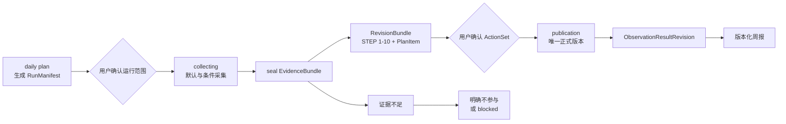

# 复盘质量验收与主流程重构方案

> **文档状态：2026-09-05 历史审计与设计快照，已冻结，非当前规范。**
> 当前产品合同见 [`PRODUCT_REQUIREMENTS.md`](PRODUCT_REQUIREMENTS.md)，当前实现状态和运行入口见 [`../README.md`](../README.md)，文档职责见 [`README.md`](README.md)。下文保留当时的事实、推断、未验证项和设计过程，其中的命令、路径、测试状态与阶段结论可能已经过时，不得据此执行当前流程或宣称当前验收状态。

> 状态：首轮本地代码闭环与 STEP/模式最小证据矩阵已实现；现有业务库迁移、真实 WorkBuddy 验收与连续五日试跑待完成
> 核查日期：2026-09-05
> 核查范围：现有 Evidence、决策卡、STEP 1-10 详细复盘、计划、Observation、周报、CLI 编排和 WorkBuddy 流程
> 当前结论：结构验收通过，复盘业务验收不通过

## 1. 本文目的

本文回答三个问题：

1. 当前生成物是否达到 [`stock-review.md`](../stock-review.md) 定义的复盘标准。
2. 哪些问题来自证据不足，哪些属于生成质量或流程设计错误。
3. 如果允许破坏性调整，下一版应如何收敛为可日用、可追溯、可回填的复盘闭环。

本文既保留旧生成物的复盘验收结论，也记录新版实现的验收基线。当前正式产品范围以 [`PRODUCT_REQUIREMENTS.md`](PRODUCT_REQUIREMENTS.md) 为准；新版领域、CLI、不可变存储、单报告发布、Observation 回填和版本化周报已经形成使用临时数据库与假证据验证的代码闭环。当前业务库尚未迁移，真实联网、真实模型、WorkBuddy 合同和连续五日 G7 验收仍未执行，因此不能把代码闭环表述为日常可用已经达标。

当前实施边界：

- 阶段 0-3 的对象合同、应用服务、SQLite schema、CLI、renderer、迁移保护和审计投影主链已落地；当前 G1-G6 自动校验覆盖结构、身份、对象链、四态、版本和回填，可行动发布还会按 STEP 字段能力及十二模式背景边界执行最小证据矩阵。
- `data/stock_review.sqlite` 仍是旧 schema；迁移只能在完整 MigrationPlan 和 `plan_hash` 获得单独确认后执行。
- 旧 CLI 与 `scripts/run_daily_review.ps1` 继续作为阶段 4 前的过渡入口，不能生成新版正式 publication；真实合同验收通过前不删除。
- 历史报告和旧记录保持原样，后续迁移只登记 `legacy_imports`，不补造新版对象链。

## 2. 验收结论

当前生成物不能作为完成的日常复盘成品，也不能直接作为实际交易行动依据。

已经成立的能力是：

- 能收集并标准化一部分市场、情绪、板块和有限个股事实。
- 能按原顺序生成完整 STEP 1-10 章节。
- 能展示证据引用、反向证据、硬缺口和待核验条件。
- 能限制模型使用本地候选和部分 STEP 字段。

阻断达标的事实是：

- 同一交易日的决策卡和详细报告没有绑定同一个不可变证据版本。
- STEP 1-5 多数只能形成倾向，尚不能完成框架要求的正式判断。
- STEP 4/5 的主线判断没有约束 STEP 6/7 的核心票和重点对象，推理链断裂。
- STEP 8 存在阈值冲突、不可达条件和与 STEP 10 对象不一致的问题。
- STEP 10 包含证据不支持的角色描述，且没有形成用户确认的正式计划。
- 当前本地持久化记录停在人工 STEP 1-5；本地报告与 SQLite 中未见真实交易日完成计划、Observation、回填和学习闭环。

因此，“生成了十个 STEP”只能证明报告结构完整，不能证明复盘完成。

## 3. 复盘达标门槛

复盘使用阻断门槛验收，不用章节数量或报告长度评分。任一 P0 门槛失败，当日复盘只能标记为草案或不可用。

| 门槛 | 达标定义 | 当前状态 |
| --- | --- | --- |
| G1 事实可信 | 日期、代码、名称、板块、指标语义与证据一致；不得把涨跌幅写成均价，不得升级未证实角色 | 不通过 |
| G2 推理连贯 | STEP 4/5 的主线约束 STEP 6/7 对象，STEP 7 对象继续进入 STEP 8/10 | 不通过 |
| G3 条件可执行 | 四档条件互斥、完整、阈值一致，并能在计划需要执行的时点观察 | 不通过 |
| G4 最终结论唯一 | 人工判断与 AI 草案的分歧已解决；同一交易日只有一个正式版本 | 不通过 |
| G5 可复现 | 报告绑定 Evidence 版本、证据截点、框架哈希、程序版本和模型响应 | 不通过 |
| G6 可回填 | 正式计划直接关联 Observation，后续结果可回查到计划和证据 | 不通过 |
| G7 日常可用 | 连续五个实际交易日完成，人工确认不超过十分钟，来源失败可降级完成 | 不通过 |

严重度口径：

- **P0**：可能写错事实、形成错误对象或给出矛盾的条件计划，阻止产物成为正式版本。
- **P1**：阻塞一个 STEP 的正式判断或业务闭环。
- **P2**：降低可读性、判断密度或追溯性，但没有直接改变事实和行动条件。

## 4. 核查样本与真实使用情况

重点样本：

- [`2026-08-17_brief_review.md`](../reports/daily/2026-08-17_brief_review.md)
- [`2026-08-17_detailed_review.md`](../reports/daily/2026-08-17_detailed_review.md)
- [`2026-08-14_detailed_review.md`](../reports/daily/2026-08-14_detailed_review.md)
- [`2026-08-07_detailed_review.md`](../reports/daily/2026-08-07_detailed_review.md)
- [`2026-07-06_to_2026-07-10_learning.md`](../reports/weekly/2026-07-06_to_2026-07-10_learning.md)

当前产物事实：

- 主目录有 8 个交易日期的详细报告，都含 10 个 STEP；另有 1 份 revised 和 1 份 `.experimental.bak` 派生产物。最新两份主报告分别为 530 行和 526 行。
- 3 份决策卡都没有填写次日参与决定、风险边界、四类条件和 Observation。
- SQLite 有 15 个 Evidence Snapshot、12 条池记录和 15 条人工 STEP 记录；池记录中有 10 条真实记录（7 active、3 paused）及 2 条样例记录。
- 人工 STEP 记录只分布在 2026-08-07、2026-08-14、2026-08-17，并且都只填写 STEP 1-5。
- `manual_previews`、`manual_final_responses` 和最终关联表均无记录。
- 唯一 Observation 是 `invalid` 的系统验收样例，没有真实 `hit` 或 `miss`。

当前本地报告与 SQLite 中没有任何一个真实交易日形成“盘后事实 → 次日正式计划 → Observation → 结果回填 → 学习”的业务闭环。2026-07-10 只证明技术链路可运行，正式需求已明确它不代表真实复盘可用。仓库外或未持久化的使用情况不在本次证据范围内。

## 5. STEP 1-10 逐项验收

| STEP | 当前可用证据与结果 | 验收 | 主要问题 |
| --- | --- | --- | --- |
| 1 大盘阶段 | 有三指数、成交额、涨跌家数和五根日 K；缺外围市场 | 部分 | 报告称“箱体中部偏强”，同时承认无法确认箱体边界；验证点也没有给出区间 |
| 2 市场风格 | 有连板梯队、有限候选容量和板块榜 | 部分 | 有限候选不能代表全市场趋势；AI 的“连板与容量并重”与人工“题材偏情绪”没有形成最终结论 |
| 3 情绪周期 | 有单日涨跌停、炸板率、最高板 | 不通过 | 缺晋级率、昨日反馈、竞价和连续情绪历史，无法判断上升、主升、退潮、混沌或冰点 |
| 4 核心板块 | 有若干离散日期的重复排名 | 不通过 | 缺 5-10 个相邻交易日的板块路径、量能和内部扩散；人工加入的抱团对象没有就近证据 |
| 5 主升阶段 | 有当日板块排名和重复出现事实 | 不通过 | 无法区分启动、主升、首次回调、轮动和破位；次日榜单排名也不能验证这些阶段 |
| 6 核心票 | 有连板、5/20 日表现、容量排序 | **P0 不通过** | 三个候选与 STEP 4/5 的 F5G、芯片主线断链；把涨跌幅误写成“五日均价/二十日均价”；核心票资格和市场角色未确认却给出 high 置信度且写“硬缺口：无” |
| 7 重点关注 | 收敛到三只四板候选 | 不通过 | 没有解释为何压过真实池对象，也没有继承主线逻辑；本 STEP 没有逐只触发和放弃条件 |
| 8 预演 | 有大盘、板块、个股四档 | **P0 不通过** | 大盘超预期同时出现 `>=1%` 和 `>=2%`；复盘日已排名第一的板块被要求“升至第一且高于复盘日”；个股预演使用全部 26 只，而 STEP 10 只使用 3 只 |
| 9 模式核验 | 十二项都被列出，并保留触发缺口 | 部分 | 优先模式没有展示满足背景的具体 K 线事实，多数模式机械绑定同三只候选，状态枚举也发生漂移 |
| 10 最终输出 | 有 conditional、总上限、对象、触发和放弃 | **P0 不通过** | 继承了 STEP 6/7 的对象断链；再次误写“均价”；把澳洋健康升级为证据不支持的“板块领涨事实候选”；没有保存为用户确认的正式计划 |

关键证据位置：

- 最新 detailed 第 15、36 行：箱体位置结论与“不能确认完整箱体边界”并存。
- 第 80、98、103 行：情绪“边际改善”与缺少连续情绪历史并存。
- 第 175、238 行：把区间涨跌幅写成均价，同时在核心票资格和市场角色未确认时记录“硬缺口：无”。
- 第 317、321 行：同一大盘超预期门槛分别为 1% 和 2%。
- 第 342、346 行：F5G 已在复盘日排名第一，却要求次日“升至第一且高于复盘日”。
- 第 515-526 行：逐候选条件继承上述断链，并在第 520 行写入未被本地证据支持的板块领涨角色。
- 最新 brief 第 11-12、23-25、42-49 行：同日旧证据值、参与/仓位占位、四档占位和 Observation 占位。

### 5.1 决策卡验收

决策卡适合快速查看事实和真实池，但当前仍是未完成工作表：

- “次日是否参与”和“总仓位与风险边界”待填写。
- 符合预期、超预期、不及预期、放弃条件全部待填写。
- Observation 待确认。
- “标准字段缺口为 0”容易被误解成证据已足够，而同一句又承认竞价、分时和身份仍需核查。

决策卡不能单独满足 STEP 8 和 STEP 10，也没有把用户填写结果保存成正式计划。

### 5.2 详细报告验收

详细报告的优点是证据边界清楚、十个 STEP 齐全。主要问题是判断密度过低和业务链断裂：

- 同一段候选容量、5/20 日排序和文件引用在多个 STEP 重复。
- STEP 8 个股四档的每条模型说明重复完整候选集合。
- 约 500 行的报告仍没有一个经用户确认、可回填的最终计划。
- 部分条件使用次日收盘结果，只能事后归类，不能作为盘中行动触发。

详细报告应降级为核查草案，直到 P0 问题消除并由用户定稿。

### 5.3 跨产物一致性

2026-08-17 决策卡写“涨跌家数待确认”和赚钱效应 81.5%，当前同日 Snapshot 与详细报告则使用上涨 4085、下跌 1012 和 99.0654%。日志与文件时间表明决策卡先生成、详细报告随后重生成；结合内容差异，高可信推断是同日 Snapshot 在两次生成之间被补充，但旧 Snapshot 未保留，不能直接还原变化过程。

这不能证明同一生成器在同一输入下自相矛盾，但证明了当前路径引用无法复现历史报告：

- Snapshot 以交易日期覆盖保存。
- 报告只记录同名文件路径。
- 报告没有生成时间、证据截点、Snapshot 哈希或程序版本。
- 用户无法判断 brief、detailed 和 experimental 文件中哪一份是正式版本。

## 6. 根因判断

### 6.1 产物先于业务状态

当前设计把 Markdown 生成当成完成，但计划、人工定稿、Observation 和回填分散在独立命令。报告可以显示“条件计划”，业务状态仍为空。

### 6.2 brief 与 detailed 双轨分担了错误的职责

brief 负责省时但不完成判断，detailed 负责完整但不保存正式结果。两者可以引用不同版本的证据，也没有共同的最终状态。

### 6.3 STEP 间只有文档顺序，没有结构约束

代码能够验证某个 STEP 是否引用允许字段，却没有验证：

- STEP 6 候选是否来自 STEP 4/5 的方向。
- STEP 7 是否解释了对象取舍。
- STEP 8 是否只预演 STEP 7 的对象。
- STEP 10 是否只执行 STEP 8 已定义的情景。

### 6.4 模型承担了不适合的工作

本地已经给出固定四档，模型又补写一套阈值，产生冲突。模型还参与角色描述和条件解释，容易把“连板候选”升级为“板块领涨候选”。

### 6.5 可选写入导致闭环永远延后

人工判断、计划、Observation 和回填都需要进入不同入口。每一步单独正确，组合后却没有一个必须完成的日常事务。

### 6.6 默认编排没有贯彻降级原则

底层 Evidence 可以记录局部失败，PowerShell 编排却会在任一 scope 非零、hhxg 失败或候选为空时提前停止。空候选和空真实池本应是合法的“不参与”输入。

## 7. 目标设计决策

下一版采用一个核心约束：

> 一次复盘 = 一个版本化 `ReviewRun` + 不可变证据与修订 + 一份当前正式 STEP 1-10 报告 + 一组结构化计划项 + 各计划项的后续结果回填。



### 7.1 `ReviewRun` 是唯一聚合根

`ReviewRun` 保存稳定身份，输入、模型响应、人工修改和报告都以不可变修订追加。生命周期由事件投影，不把会变化的状态伪装成不可变对象：

```text
collecting → evidence_ready → draft_ready → published
```

模型状态独立于主状态。直接来源采集失败会冻结为 `unavailable` capture；其它应用服务失败不推进当前事件投影。已落盘或已入库的不可变中间记录由同一 operation ID 幂等恢复，成功后补齐完成事件。领域对象保留通用 `operation_failed` 事件类型，但当前正式应用服务没有把所有异常自动转换成失败事件，也不会用一个笼统 `failed` 状态覆盖已经冻结的证据或草案。

规则：

- 每次真实运行生成唯一 `run_id`，同日重跑也不覆盖旧运行。
- 单个数据源失败记为 `unavailable`，运行继续生成降级草案。
- 空池、空候选是合法输入，最终可以明确为“不参与”。
- 模型状态单独记录为 `not_requested/pending/completed/unavailable`；没有模型时仍生成规则版草案，未完成的判断保持缺口，参与决策保持 `undecided`，直到用户在 `propose-actions` 明确选择 `actionable` 或 `non_participation`。
- 日期错配、代码越界、证据污染、模型请求指纹不一致等完整性错误才阻断运行。
- 生命周期事件只追加，使用事件 ID 保证重试幂等；当前状态是可重建投影。
- `collecting` 允许追加 RunManifest 中尚未完成的 capture；所有 capture 必须记录为 `available/unavailable/skipped` 后才能 seal EvidenceBundle。
- EvidenceBundle seal 后禁止继续 attach；需要新增来源、扩大范围或修正原始事实时，创建新的 RunManifest 和 run，不改写旧运行。
- `evidence_ready` 可以直接生成无模型 RevisionBundle，也可以追加模型请求/响应后生成；模型失败不会退回 collecting。
- `draft_ready` 可以追加人工编辑形成的新 RevisionBundle；发布失败后仍停留在该状态，可用新 operation ID 重试。
- 每个模型请求绑定 `evidence_bundle_id`、基础 `review_revision_id`（初稿时为空）和请求生成时的期望当前修订。模型响应提交时必须再次比较；人工修订后到达的旧响应直接拒绝，不能改写当前草案。
- PlanItem 的结果分别回填，发布后的 ReviewRun 不随 Observation 的不同到期日切换成统一的 `evaluated` 状态。
- 只有交易日正式版本索引指向的 `published` 修订可以称为正式复盘；其它运行和修订统一显示“草案”或“已取代”。

每个运行至少保存：

- `run_id`、交易日、采集时点和证据截点。
- 框架版本、框架内容哈希、程序版本和渲染器版本。
- 每个来源的状态、原始响应哈希、标准化证据及失败原因。
- 模型请求、请求指纹、模型标识、模型响应和响应哈希。
- 不可变 `review_revision_id`，作为一个 RevisionBundle 同时包含 STEP 1-10、PlanItem、人工修改和最终选择，避免 ReviewRevision 与 PlanItemRevision 互相引用。
- 不可变 ActionSet、池子动作、Observation 动作及最终报告哈希。

### 7.2 Evidence 改为不可变版本

当前目录：

```text
data/evidence/<trade-date>/<run-id>/captures/<slot-id>.json
reports/daily/YYYY-MM-DD/<run_id>/
  revisions/<review_revision_id>.md
  blobs/<report_hash>.md
```

要求：

- 新证据只能产生新 `evidence_bundle_id`，不能覆盖旧 Snapshot。
- 报告引用明确文件、内容哈希和截点。
- 截点后事实可以用于后续回填，但不能修改已经 published 的判断修订。
- 旧 Snapshot 和报告登记为 `legacy`，不原地改写历史内容。

### 7.3 每日只保留一份正式报告

删除 `brief_review.md` 与 `detailed_review.md` 的长期双轨。publication 索引选中的单份正式报告包含三个视图，它们都从同一个 RevisionBundle 渲染：

1. **顶部决策视图**：是否参与、总风险、重点对象、触发、放弃，以及本次批准计划新建的待回填 Observation。
2. **STEP 1-10 正文**：每步只保留结论、关键证据、反证/缺口和次日验证点。
3. **证据附录**：被拒绝候选的 ID/原因、全部十二模式状态和去重后的来源引用；完整候选对象保留在被最终修订替代的草案中。

顶部决策视图是 STEP 10 的投影，不是一份独立报告。草案按 `review_revision_id` 保存，正式报告按内容哈希保存；`draft.md`、`review.md` 或 `latest` 只能作为可重建的界面标签，不能作为权威文件路径或被原地覆盖。

正式正文必须嵌入 publication ID 与 ActionSet ID，并给出 `review_publications.content_hash`、`review_publications.report_hash` 和 `action_sets.content_hash` 的精确查询定位。ActionSet 内容哈希包含报告哈希，publication 内容哈希又在正式事务提交时产生；把这些最终值写回同一份被哈希正文会形成循环依赖，因此正文不得伪造或自嵌这些包裹哈希。`daily finalize` 回执必须返回实际 `action_set_hash`、`publication_hash` 和 `report_hash`，`daily verify` 再按 ID、数据库记录、blob 文件名和文件 SHA-256 联合核验。提案预览与最终 blob 使用相同字节，正文状态统一写为 `finalized` 并声明正式性及当前性以 publication 投影为准，不能写成已经发布，也不能遗留“待最终确认”。

同一交易日允许存在多个运行候选，但 `review_publications` 必须以交易日建立唯一当前索引。发布新运行时，ActionSet 必须显式声明被取代的 publication ID；并发发布使用唯一约束和期望旧版本校验，冲突时全部拒绝，不允许两份报告同时成为“当前正式版本”。旧 publication 及报告内容继续保留为 `superseded`。

### 7.4 建立 STEP 依赖约束

正式计划必须满足以下链路：

```text
STEP 4/5 方向
  → STEP 6 角色与身份
  → STEP 7 少量重点对象
  → STEP 8 同对象情景
  → STEP 10 最终行动
  → Observation
```

约束：

- STEP 6 对象不属于 STEP 4/5 方向时，必须明确记录“独立抱团/逆势锚/其它原因”，否则不能进入 STEP 7。
- STEP 7 只记录对象选择理由、与主线的关系及未选择真实池对象的原因，不再保存另一套触发和失效条件。
- STEP 8 只预演 STEP 7 的对象；大盘、板块、个股条件必须使用同一对象、同一数据源和同一主指标，并直接使用当前 RevisionBundle 中唯一的 `plan_item_id`。
- STEP 10 只投影 STEP 8/PlanItem 的对象、条件和行动，不保存第三套条件文本。
- 任一链接缺失时，对象只能留在证据附录，不能出现在行动区。

### 7.5 收回模型的事实与阈值权限

本地代码负责：

- 事实、代码、名称、板块和角色标签。
- 候选集合、排序分母和证据字段。
- 四档边界、互斥性、单位、时点和默认风险上限。
- STEP 依赖和最终计划结构。

模型只负责：

- 在允许证据内压缩解释。
- 给出反向证据和仍待确认的问题。
- 对本地生成的计划草案提出文字修订，不新造数字阈值。

用户在定稿前可以编辑阈值和行动；每次编辑都联合生成新的 RevisionBundle，STEP 8、STEP 10 投影和 PlanItem 同步换版，记录修改前后值和确认时间，并重新执行 G1-G6、四档互斥、时点和对象链校验。校验失败的修订不能发布。

### 7.6 计划和 Observation 使用同一结构

删除独立的占位 `plan create`。草案 RevisionBundle 保存 `candidate_plan_items`；最终 RevisionBundle 只保存用户选择后的 `approved_plan_items`，STEP 8 和正式计划共用其中唯一的 `PlanItem`：

- RevisionBundle 的 `review_revision_id`、稳定 `plan_item_id` 和被替代修订 ID。
- 对象和角色。
- 可验证假设。
- 符合、超预期、不及预期、放弃四档。
- 成立条件、失效条件和四档对应行动。
- 可观察触发时点。
- 行动类型和最大风险。
- 证据引用和最晚回填日期。

`daily propose-actions` 必须联合生成一个 FinalizationProposal，其中包含最终 RevisionBundle、ActionSet 和覆盖二者的组合哈希。被拒绝候选只以 ID 和拒绝原因保存在决策审计元数据中，不进入最终 PlanItem 或行动区；明确不参与时，最终 RevisionBundle 不包含任何行动对象或条件。正式报告只从这个最终 RevisionBundle 渲染，不能从草案状态和数据库动作拼接。

任何包含未来可验证判断的 approved 计划项都必须在同一个 ActionSet 中创建 Observation；不需要回填的文字只能作为复盘备注，不能成为最终 PlanItem。Observation 引用不可变 RevisionBundle 中的计划项，并冻结一份与该修订哈希一致的必填字段快照，后续不得独立编辑这些字段：

```text
Observation(
  observation_id,
  review_revision_id,
  plan_item_id,
  hypothesis,
  confirmation_condition,
  invalidation_condition,
  evidence_references,
  review_deadline,
  created_at
)
```

用户在最终动作确认中显式批准计划项和对应 Observation 创建。提交时必须验证字段快照与 `review_revision_id + plan_item_id` 完全一致。后续日常运行主动展示到期或逾期记录，但仍由用户确认结果。旧 Observation 表在迁移时重命名为 `legacy_observations_v0`，原记录及内容哈希登记到 `legacy_imports`；系统不伪造 RevisionBundle 关系，周报也不把 legacy 记录与新链路样本混算。

Observation 基础记录不保存 `status/actual_result/reason`。没有结果修订时，查询投影确定性显示为 `pending`；用户可以追加 `hit/miss/invalid` 的 `ObservationResultRevision`，`miss/invalid` 必须使用固定原因分类：判断错误、证据不足、观察或执行偏差、样本无效。每个结果修订记录 `result_revision_id`、期望旧修订 ID、实际结果、原因、回填证据、记录时间和被替代修订 ID。纠错只能追加新修订，并用期望旧 ID 防止并发覆盖；当前结果完全由最新有效修订投影。

`observation propose-result` 只读生成规范 ObservationResultAction 和哈希，完整展示目标记录、期望旧修订、结果、原因、证据和影响；用户单独确认后，`observation record-result` 才追加结果修订与审计事件。日常 FinalizationProposal 也可包含到期结果，但必须使用同样的期望版本校验。

周报本身也按内容哈希发布，并冻结所引用的日报 publication、ObservationResultRevision、池状态历史截点、框架和程序版本。后续纠错生成新周报修订，不能静默改变旧周报。

### 7.7 WorkBuddy 日常确认点

1. **运行确认**：展示带哈希的 RunManifest，列出本次允许的数据源、模型范围、文件和数据库影响。确认后，manifest 内已经授权的 capture 不再逐来源重复询问。
2. **真实模型确认（仅在使用模型时）**：展示已经冻结的模型请求、模型 ID、请求指纹和数据边界，再确认是否把该请求交给真实模型。没有模型时不存在这一确认点。
3. **最终动作确认**：展示 ActionSet 差异，统一确认报告定稿、池子更新、计划批准、Observation 创建及到期项回填。

RunManifest 由本地 `daily plan` 根据显式 CLI 参数生成并输出规范 JSON；该命令只读，不执行联网或业务写入。它至少包含 `manifest_id`、预分配 `run_id`、交易日、创建/过期时间、每个来源的名称/采集范围/输入输出位置/联网与写入影响、模型使用、预期数据库动作和规范序列化哈希。`daily start` 接收用户批准的完整 manifest 后才持久化并执行。

RunManifest 的 CaptureSlot 支持带明确缺口谓词、日期/字段范围，以及可选的对象和记录上限。当前公开 CLI 的 `SOURCE:SCOPE?PREDICATE` 语法会固定交易日期与 scope 字段；只有清单正文实际设置了对象或记录上限时，才能把它们视为授权边界。谓词不成立时记录 `skipped`；成立时 WorkBuddy 可在第一次运行确认的授权范围内调用连接器，不再重复确认。每个 capture slot 有独立 operation ID，只能被完成一次；相同输入重放返回原事件，不重复联网或写入。

ActionSet 由本地 `daily propose-actions` 根据冻结的 RevisionBundle 和用户选择生成，同样使用规范 JSON，绑定 `run_id`、最终 `review_revision_id`、RunManifest、全部业务动作、影响范围、过期时间和内容哈希。每个可变目标都必须携带用户预览时的期望版本或哈希：交易日旧 publication ID、每个池对象的最新状态事件 ID、每条 Observation 的最新 ResultRevision ID，以及其它被修改聚合的当前版本。`daily finalize` 在同一事务内逐项比较，任一对象已经变化就拒绝整个 ActionSet，不能用旧差异覆盖其它运行的更新。

不使用真实模型且没有临时扩围时，标准路径只有运行确认和最终动作确认。使用真实模型时另有模型确认。用户临时要求新增来源或扩大范围时必须产生新的 RunManifest，并使旧 manifest 失效；新范围必须重新展示和确认。没有进入 manifest 的补充证据继续保留为缺口。

### 7.8 正式发布协议

SQLite 事务不能覆盖文件系统，因此定稿使用“不可变文件先就绪、数据库后发布”的可恢复协议：

1. 完成全部业务校验，在正式目录同一磁盘写临时报告并计算哈希。
2. 使用同目录硬链接执行原子且不覆盖的目标创建，把报告放入内容寻址路径；此时文件只是未引用 blob，不是正式报告。
3. 确认目标 blob 存在且哈希一致后，幂等保存最终 RevisionBundle、FinalizationProposal 和 ActionSet 作为未应用的不可变中间记录；这些记录还不是正式 publication。
4. `apply_action_set` 在一个 SQLite IMMEDIATE 事务中重新比较全部期望版本，并原子应用 publication、池事件、Observation/结果修订、审计 outbox 和 ActionSet 应用结果。
5. publication 更新必须携带期望旧 ID；并发冲突或任一业务动作失败时，步骤 4 的全部业务状态一起回滚。
6. 事务提交后，数据库中的 publication 索引成为正式版本的唯一入口。提交前崩溃可能留下未引用 blob、未应用 RevisionBundle、FinalizationProposal 或 ActionSet；相同提案重试会验证并复用它们，不会把这些中间记录误认为正式报告。

必须用故障注入覆盖临时文件写入、原子无覆盖发布、事务开始、业务动作、publication 更新和提交前后的失败点；每次失败后都要证明事务前状态未被部分应用，或在提交后可由同一提案安全重放。

ActionSet 的业务应用与对应 `audit_event`/outbox 在同一事务保存。其它正式写命令在领域记录持久化后追加结构化审计和 outbox，并可借同一 operation ID 的幂等重试补齐。审计至少记录命令、`run_id`、交易日期、RunManifest、ActionSet、数据源、输出和状态。`logs/stock_review.log` 作为可重建投影，通过 outbox 幂等写入；日志文件写入中断不能丢失数据库中的权威审计事件。

### 7.9 降级与发布等级

`degraded` 是证据质量标签，不是“可以忽略错误”的状态。当前 `daily propose-actions` 和 `daily finalize` 都会重新读取 Evidence Capture，并根据 G1-G6 的结构、身份、对象链、四态、版本溯源、回填校验和 STEP 最小证据矩阵给出以下等级：

| 等级 | 条件 | 是否可发布 |
| --- | --- | --- |
| `blocked` | 日期/来源错配、事实语义错误、对象越界、角色无证据、条件冲突、哈希或依赖链失败 | 否 |
| `non_participation` | STEP 1-6 已完成、有证据引用且没有最低能力缺口；STEP 9 已完成、有证据引用，十二模式均为 `confirmed` 或 `not_matched`；没有行动结构且用户明确确认不参与 | 是，正式报告不得含 approved 行动计划 |
| `actionable` | 用户确认全部 STEP 与计划，且当前 G1-G6 自动结构和证据身份校验通过 | 是 |

判定顺序不可调整：先检查事实与完整性 P0，任何真实冲突都直接 `blocked`；再检查是否存在行动结构。只有报告完全不存在行动对象、条件和 approved 计划，并且用户明确确认不参与时，G2/G3/G6 才能标记为 `not_applicable`。一旦报告包含行动结构，这三个门槛必须通过，不能用 `non_participation` 绕过冲突。

当前实现会拒绝 EvidenceBundle 外引用，并核对计划股票的代码、名称、交易所、板块和角色来源。可行动修订的每个 STEP 还必须由该 STEP 自己引用的非空标准化字段满足最低能力组；`snapshot` 只按其真实非空的 market、sentiment、sectors、stocks 及历史子字段提供能力，空对象不能充当通配符。连续历史能力至少要求两个不同的规范样本日期，单根个股或板块日线不能代替跨日比较。STEP 9 必须保存十二项结构化模式评估，每项分别绑定状态、对象、自己的 refs 和证据缺口；`confirmed` 必须具备该模式定义内的背景与触发类别，缺少竞价、分时、日线、前后日反馈或监管事实时只能保留未满足、不可用或触发待核验。该矩阵只证明最低字段与引用边界，不证明市场判断语义正确，最终结论仍需人工核对。

模型请求与响应共用本地确定性边界：schema version 2 的请求不再携带完整合并快照，而是在 `normalized_evidence_by_step` 中保存每个 capture 按 STEP 职责裁剪后的正文和引用；模型生成某一步时只能读取同编号视图。响应校验再次执行同一投影，`snapshot` 中的个股、板块或情绪字段不能串入只允许市场事实的 STEP 1。裁剪视图只保留 `source`、`trade_date`、`sample_date` 三个溯源元字段；`schema_version` 和 `quality` 不参与事实白名单。一至五位整数、小数、百分比和六位代码都会和本 STEP 视图比对；完整 ISO 日期独立比对，不把月、日拆成普通数值白名单。校验还会提取显式名称、代码、符号和板块实体，拒绝未知主体的身份、涨跌和“今日表现”等普通事实句。`唯一`、`主线`、`龙头`、`核心`、`涨跌停`、`强弱`、`主升/退潮` 等高风险角色或状态词也必须已出现在本 STEP 冻结证据或基础修订中。明确写为待确认的问题可以保留。required 模式还要求当前运行存在已完成的授权模型响应，且最终修订继承该响应哈希，否则不能生成提案或发布。该检查仍是启发式规则，不是通用中文命名实体识别，也不能证明同义改写的真实性；它用于阻断可确定识别的越界断言，剩余语义风险继续由人工定稿承担。

## 8. CLI 与模块收敛

### 8.1 当前公开 CLI

```text
daily plan --date DATE (--capture SOURCE:SCOPE | --conditional-capture SOURCE:SCOPE?PREDICATE)+ [--output-dir DIR] [--evidence-dir DIR] [--database DB] [--model MODEL_ID]... [--model-required]
daily start --manifest-base64-stdin --manifest-hash HASH [--database DB] [--audit-log LOG]
daily attach-evidence --run-id ID --date DATE --manifest-hash HASH --operation-id ID --input-base64-stdin [--database DB] [--audit-log LOG]
daily seal-evidence --run-id ID --date DATE --manifest-hash HASH [--database DB] [--audit-log LOG]
daily complete-local --run-id ID --date DATE --manifest-hash HASH --expected-current-revision-id ID_OR_null --operation-id ID [--framework PATH] [--database DB] [--audit-log LOG]
daily prepare-model --run-id ID --date DATE --base-revision-id ID_OR_null --expected-current-revision-id ID_OR_null --model-id ID --operation-id ID [--database DB] [--audit-log LOG]
daily complete-model --run-id ID --date DATE --request-id ID --base-revision-id ID_OR_null --expected-current-revision-id ID_OR_null --model-response-base64-stdin --manifest-hash HASH --operation-id ID [--framework PATH] [--database DB] [--audit-log LOG]
daily revise --run-id ID --base-revision-id ID --expected-current-revision-id ID --edits-base64-stdin --operation-id ID [--database DB] [--audit-log LOG]
daily propose-actions --run-id ID --review-revision-id ID --selections-base64-stdin [--database DB] [--output-dir DIR]
daily finalize --proposal-base64-stdin --proposal-hash HASH [--database DB] [--audit-log LOG]
daily show --run-id ID [--database DB]
daily verify --run-id ID [--database DB]
weekly create --end-date DATE [--start-date DATE] [--database DB] [--output-dir DIR] [--audit-log LOG]
pool list [--type watch|hot] [--record-kind real|sample] [--database DB]
observation list [--date DATE] [--status pending|hit|miss|invalid] [--due-on-or-before DATE] [--database DB]
observation propose-result --observation-id ID --expected-result-revision ID_OR_null --status hit|miss|invalid --actual-result TEXT [--reason REASON] --evidence-reference REF [--evidence-reference REF]... [--note TEXT] [--database DB]
observation record-result --action-base64-stdin --action-hash HASH [--database DB] [--audit-log LOG]
database plan-migration --database DB --backup-path BACKUP [--target-version 1] [--evidence-dir DIR] [--daily-report-dir DIR] [--weekly-report-dir DIR]
database migrate --database DB --plan-base64-stdin --plan-hash HASH --confirmed [--audit-log LOG]
database project-audit-log [--database DB] [--log LOG] [--limit N]
```

`--capture source:scope` 和 `--conditional-capture source:scope?predicate` 必须逐项展开到 RunManifest；真实采集仍显式携带交易日期、来源名称、范围和输出位置。`attach-evidence` 是通达信等受控外部原始信封的唯一提交入口，适配器只消费 manifest 允许的对象和字段，不能通过 stdin 或临时文件绕开来源、范围和日期校验。

状态转换固定为：

| 命令 | 前置 | 事件与后置 |
| --- | --- | --- |
| `daily plan` | 无 | 只输出待批准 RunManifest，不创建 run |
| `daily start` | 有效且已批准的 manifest | `run_started`，进入 collecting；执行 manifest 内直接来源 |
| `daily attach-evidence` | collecting，capture slot 未完成 | 追加 capture 结果，仍为 collecting |
| `daily seal-evidence` | 所有 slot 已 available/unavailable/skipped | `evidence_bundle_sealed`，进入 evidence_ready；此后拒绝 attach |
| `daily prepare-model` | evidence_ready 或 draft_ready | 生成绑定 EvidenceBundle、基础修订和期望当前修订的模型请求；主状态不变 |
| `daily complete-model` | evidence_ready 或 draft_ready，请求基础与当前修订仍匹配 | 追加模型 RevisionBundle，进入或保持 draft_ready；迟到响应拒绝 |
| `daily complete-local` | evidence_ready 或 draft_ready，期望当前修订仍匹配 | 追加规则版 RevisionBundle，进入或保持 draft_ready |
| `daily revise` | draft_ready，base 等于期望当前修订 | 追加联合换版 RevisionBundle，保持 draft_ready |
| `daily propose-actions` | draft_ready，选择基于当前修订 | 只输出待批准 FinalizationProposal（最终 RevisionBundle + ActionSet + 组合哈希），不改变状态 |
| `daily finalize` | draft_ready，proposal 内全部期望版本仍匹配 | 执行发布协议，成功后 published；失败保持 draft_ready |
| `daily show/verify` | 任意已存在 run | 只读，不改变状态 |

`daily complete-local` 初次生成草案时，`expected-current-revision-id` 传字面量 `null`。模型请求没有基础草案时，`base-revision-id` 和 `expected-current-revision-id` 都传字面量 `null`；存在草案后，两者必须使用同一明确修订 ID。请求始终绑定已经 seal 的 `evidence_bundle_id`。

### 8.2 阶段 4 验收后删除或并入

- `scripts/run_daily_review.ps1`
- `review create`
- `review create-brief`
- `review build-context`
- `review draft-final`
- `review prepare-detailed`
- `review create-detailed`
- `review record-step`
- `review record-preview`
- `review record-final`
- `plan create`
- 各自生成旁支 Markdown 的 history/scoring 命令
- 分散的业务迁移命令，统一进入 `database migrate`

底层 AKShare、hhxg、通达信、龙虎榜、美股和板块 K 线适配器保留。历史归纳、评分和候选构建改为 `ReviewRun` 内部能力，不再各自产生正式报告。

### 8.3 建议源码边界

```text
src/stock_review/review_runs/review_run.py
src/stock_review/review_runs/review_run_event.py
src/stock_review/review_runs/run_manifest.py
src/stock_review/review_runs/review_revision.py
src/stock_review/review_runs/action_set.py
src/stock_review/review_runs/run_daily_review.py
src/stock_review/review_runs/complete_daily_review.py
src/stock_review/review_runs/complete_model_review.py
src/stock_review/review_runs/revise_daily_review.py
src/stock_review/review_runs/finalize_daily_review.py
src/stock_review/review_runs/validate_model_response.py
src/stock_review/review_runs/verify_daily_review.py
src/stock_review/evidence/build_evidence_bundle.py
src/stock_review/observations/review_due_observations.py
src/stock_review/learning/create_weekly_review_run.py
src/stock_review/storage/review_run_repository.py
src/stock_review/storage/plan_review_run_migration.py
src/stock_review/storage/project_audit_log.py
src/stock_review/reports/render_review_run.py
src/stock_review/review_run_cli.py
```

现有 `create_detailed_review.py` 中已经具备价值的字段白名单、请求指纹、候选范围和模型响应校验，先迁移到 `validate_model_response.py`，再删除旧编排，避免重写时丢失边界。

依赖方向固定为：

```text
CLI / WorkBuddy
  → application（run / complete / finalize / verify）
    → domain（ReviewRun、EvidenceBundle、RevisionBundle、PlanItem、Observation）
      → repository 与 source port
        ← storage / AKShare / hhxg / 通达信等 adapter 实现

reports 只读取已校验的 domain projection
domain 不依赖 CLI、HTTP、SQLite 或 Markdown renderer
```

`planning` 和 `observations` 通过 domain ID 关联 ReviewRun，不反向依赖应用服务。当前 `AGENTS.md` 已同步依赖红线，`tests/architecture/` 检查领域层不反向依赖基础设施、CLI 不直连 SQLite/HTTP、renderer 不产生业务判断。

## 9. 迁移计划

### 阶段 0：冻结目标契约

改动：

- 把本文的阻断门槛和 `ReviewRun` 契约写入正式需求。
- 统一 README、PRODUCT_REQUIREMENTS、stock-review、AGENTS 和 WorkBuddy 的默认入口、依赖方向、审计日志、STEP 10 边界、模式状态和证据字段口径。
- 给现有报告登记 `sample/legacy/experimental/superseded`，不修改其正文。

验收：

- README、PRODUCT_REQUIREMENTS、stock-review、AGENTS 和 WorkBuddy 五份材料对默认流程和正式产物只有一种说法。
- 历史文件不会再被误认为当前正式计划。

### 阶段 1：盘点、迁移保护与版本化运行底座

改动：

- 先盘点并映射现有 Evidence 数据库记录、池及多板块/状态历史、人工 STEP/preview/final/关联、Observation/review、计划文件、日报和周报索引。
- 为数据库引入 schema version；提供只读 `database plan-migration`、明确备份路径、正式 `database migrate`、失败恢复和幂等重跑。
- 新增 ReviewRunEvent、EvidenceCapture、RevisionBundle、ActionSet、Observation、ObservationResultRevision、WeeklyRevision、日报/周报唯一 publication、audit event 和 audit outbox schema。
- 新增不可变目录、RunManifest、内容哈希和 `daily verify`。
- 旧 Snapshot、人工记录、Observation/review、日报和周报只读登记到 `legacy_imports`；旧 Observation 的当前结果按原记录冻结到 legacy 区，不补造 ResultRevision 或 PlanItem 关系。新表的重复初始化和迁移重跑必须幂等。

数据库迁移不属于日常 RunManifest。`database plan-migration` 必须只读输出环境、目标库、当前/目标 schema version、目标表、预计影响数量、备份路径、旧表计数/哈希、历史文件清单/哈希、逐项回查 SQL、失败恢复步骤和唯一 `content_hash`；CLI 展示的 `plan_hash` 就是该 `content_hash`。`database_sha256` 是在同一只读事务内对完整 schema、全部表记录（BLOB 规范化）以及 `application_id`、`user_version` 计算的规范逻辑快照指纹，包含已提交但尚未 checkpoint 的 WAL 页，不是主文件字节哈希。用户针对该哈希单独明确授权后，`database migrate` 才能执行；迁移先取得 SQLite `BEGIN IMMEDIATE` 单写者门禁，在门禁内复核计划并使用 SQLite Online Backup 创建一致性快照，以 `PRAGMA integrity_check` 和同一逻辑快照指纹验证。旧表重命名、新 schema、legacy 登记和迁移审计在同一事务中提交；失败或进程中断由 SQLite 原子回滚，再次执行必须同时核验目标库与备份，不得用旧备份自动覆盖主库或删除主库 sidecar。日常运行、测试库授权或此前写入授权不能代替迁移授权。

验收：

- 同日重跑产生不同 run_id，旧运行字节不变。
- 修改任何冻结输入后，`daily verify` 明确失败。
- 数据源部分失败和空候选仍能得到明确的 `blocked/non_participation/actionable` 判定。
- 迁移前后逐类记录数量、字段内容哈希、外键关系、池状态历史和关键查询结果等价；失败或进程中断后事务完整回滚，原计划与已验证备份可安全重放。

### 阶段 2：统一编排与单报告

改动：

- Python 应用服务接管 PowerShell 编排。
- brief 和 detailed 改为同一 ReviewRun 的一个 renderer。
- 落实 STEP 4/5 → 6/7 → 8/10 结构校验。
- 去重证据和候选长列表，只在附录完整展示。

验收：

- 一次运行可保留多个不可变草案修订，但只有一个当前草案；同一交易日只有 publication 索引指向的一个正式版本。
- P0 内容错误均有自动化回归测试。
- 正文没有“待人工填写”；未完成字段只能发布为明确的 `non_participation`，或保持 draft，不能伪装成 actionable。

### 阶段 3：计划、Observation 与 ActionSet

改动：

- 删除占位计划文件。
- 用户一次批准或拒绝计划项；批准未来可验证计划时同时明确创建对应 Observation。
- 按正式发布协议先准备内容寻址报告，再在一个 SQLite 事务中提交 ActionSet、池子、计划、Observation、审计事件和 publication 索引，使用 action_set_id 幂等。
- 显式迁移旧 Observation；无法关联的旧记录保留 legacy，不补造关系。
- 启用 ObservationResultRevision 的追加、纠错和期望版本校验；版本化周报固定引用的日报 publication、结果修订和池历史截点。
- 启用 audit outbox 的幂等日志投影和失败后恢复。

验收：

- 文件准备或任一数据库动作失败时不产生部分业务写入，也不切换正式 publication。
- 重试同一 ActionSet 不重复创建记录。
- 周报可以追溯 `run_id → review_revision_id → plan_item_id → observation_id → result_revision_id`。
- 周报重生成会创建新 WeeklyRevision 并显式 supersede，旧周报与旧结果引用保持不变。
- audit outbox 重放不会重复日志事件，文件日志中断后可由数据库权威事件恢复。

### 阶段 4：WorkBuddy 切换并删除旧链

改动：

- WorkBuddy 改用 manifest、run、complete、finalize 协议。
- 真实试跑通过后删除 PowerShell、旧 CLI 和旧 renderer。
- 不保留长期双写、兼容开关或隐藏旧入口。

验收：

- 不使用真实模型且不扩大 manifest 范围时，正常日常运行最多两个确认点；使用真实模型时增加一次模型请求确认。
- 实际联网和写入不超过 manifest。
- 仓库不存在可生成第二份正式日报的入口。
- `logs/stock_review.log` 可以从结构化 audit event/outbox 幂等恢复。
- 在真实 WorkBuddy 交互环境完成一次合同验收：记录用户批准的 RunManifest/ActionSet 哈希、确认事件和连接器工具调用参数，逐项证明来源、对象、日期、字段和输出都未越过 capture slot。
- 不使用真实模型的标准 conditional capture 路径，UI 确认事件正好为两次；真实模型调用或主动扩大范围会产生相应额外确认。合同验收材料保存在用户指定的仓库外目录或临时 QA 目录，不把会话过程材料提交到业务仓库。

## 10. 验证方案

### 10.1 自动化闭环

新增进程级端到端测试，使用本地 fake HTTP server、确定性 fake model、真实 CLI 子进程、临时 SQLite 和临时文件系统：

- 当前已覆盖任一来源失败后其它 capture 保留、失败来源进入 `unavailable` 并可继续生成保守草案；STEP/模式最小证据矩阵会拒绝用单一 stocks 或空 snapshot 把 STEP 1-10 全部标记完成，同时允许证据不足时发布明确的 non_participation。
- 空候选、空池、paused/removed 池均能完成；非 active 对象不进入计划。
- 相同冻结输入、模型响应和 renderer 版本产生字节级一致报告。
- 篡改 Evidence、模型响应或报告后，`daily verify` 失败。
- 每个 approved 计划项四档完整、互斥、单位一致、时点可观察。
- STEP 6-10 对象链不一致、人工编辑破坏边界或 PlanItem 引用漂移时拒绝发布。
- 模型跨 STEP 字段、池外代码、虚构数字、角色升级和自造阈值全部拒绝。
- RunManifest 和 ActionSet 的篡改、过期、跨日使用、跨 run 重放及扩大范围全部拒绝。
- 同一交易日两个运行并发发布时只有一个能更新 publication；另一个保持未发布且不产生业务动作。
- 两个不同交易日的 ActionSet 并发更新同一池对象或同一 ObservationResult 时，期望事件 ID 过期的一方整体拒绝。
- 模型请求发出后若人工已经产生新修订，迟到的模型响应不能成为当前草案。
- FinalizationProposal 中的批准结果、最终 RevisionBundle、ActionSet 和渲染报告必须由同一组合哈希约束，不出现报告仍为 candidate 而数据库已 approved 的分裂。
- 对正式发布协议逐点注入文件和数据库故障，验证 ActionSet 幂等、旧 publication 不丢失且不存在半成品业务状态。
- 后续运行能展示到期 Observation；回填后周报可追溯完整链路。
- Observation 纠错产生新 ResultRevision；旧周报字节和引用不变，新周报明确 supersede 旧版本。
- 当前数据库 fixture 能显式迁移；各表数量、字段哈希、外键、池状态历史和关键查询结果保持等价，并发写被单写者门禁拒绝，失败或进程中断后的安全重放与重复迁移不会损坏关系。
- 每个写命令产生可按 `run_id`、RunManifest 和 ActionSet 回查的结构化审计事件，并能恢复文件日志投影。

### 10.2 五日产品验收

连续五个实际交易日同时满足：

- 每日都生成可验证 ReviewRun。
- 没有 P0 错误。
- 用户最终确认在十分钟内完成。
- 数据源局部失败不会造成无分类中断；系统按最小证据矩阵发布 actionable 或明确不参与，完整性错误仍必须 blocked。
- 每日只有一个正式版本。
- 至少一条用户真实创建的 Observation 跨日按期回填为 `hit` 或 `miss`，并作为有效样本进入周报；`sample/system_validation/invalid/pending` 不计入验收。

满足以上条件，只能证明“日常复盘闭环可用”。

### 10.3 交易指导能力验收

工程测试不能证明交易判断有效。进入真实资金使用前，应先完成一段独立的影子跟踪：

- 运行前固定评价指标和停止条件，避免事后挑选有利口径。
- 冻结影子执行协议，包括触发时点、模拟成交价、退出期限、仓位、费用与滑点、未成交处理及唯一行情源；中途改变规则后重新开始该轮验收。
- 记录触发是否出现、计划当时是否可执行、失效条件、最大不利波动和结果。
- 区分判断错误、证据不足、观察遗漏、执行偏差和样本无效。
- 与简单基线比较，检查命中率、盈亏比、回撤和放弃条件是否有效。
- 样本不足时只报告事实，不升级规则，也不宣称系统能够指导交易。

具体样本量和风险阈值属于用户交易方法，应在影子跟踪开始前单独确定，不能由系统事后生成。

## 11. 历史产物处理原则

- 2026-07-06、07-07、07-10 的旧日报、计划和周报登记为 `sample` 或 `system_validation`。
- 含 `条件买入` 或 `单股仓位` 任一旧策略措辞的旧 detailed 登记为 `legacy_policy`，不进入当前正式索引。
- 相对盘点路径含 `experimental` 的产物登记为 `experimental`；相对路径含 `revised` 或 `superseded` 的产物登记为 `superseded`。
- 历史 Evidence 和报告默认不删除、不移动、不原地修正。
- 后续清理或迁移必须先生成分类清单和备份方案，再按用户授权执行。

## 12. 事实、推断与未验证风险

### 已确认事实

- 最新 detailed 的十个 STEP 结构完整，但包含本文件列出的文本冲突、对象断链和角色证据错误。
- 当前本地 SQLite 没有 manual preview、manual final 或有效 hit/miss Observation。
- 决策卡与详细报告没有 Evidence 版本和截点锚点。
- 默认 PowerShell 编排在步骤返回非零时停止。

### 高可信推断

- 文件时间、重生成日志和内容差异支持以下推断：2026-08-17 决策卡生成后，同日 Snapshot 很可能补入了新证据，再用于 detailed 重生成。旧 Snapshot 未保留，因此变化过程无法直接复原。

### 尚未验证

- 未联网核对任何行情、股票身份和第三方字段口径。
- 未运行现有测试，当前工作树是否全部通过仍未知。
- 未使用切换后的模型重新生成同一冻结输入，无法判断新模型能减少多少内容错误。
- 未完成连续五日真实试跑和影子跟踪，无法评价交易判断的有效性。
- 多入口、多次确认和 plan 双轨可能增加日常摩擦，但现有产物不能证明它们就是 August 真实使用停在 STEP 1-5 的直接原因，仍需用户使用验证。
